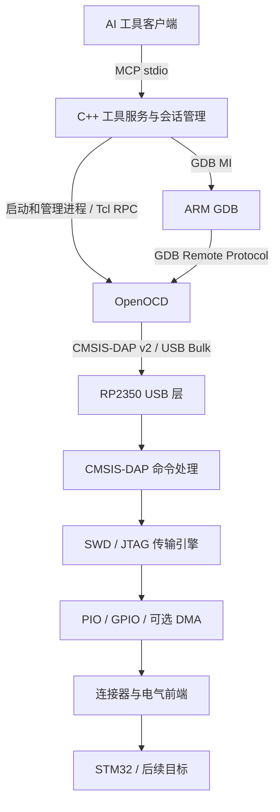

# RP2350 通用下载调试器：架构提案 v0.1

日期：2026-11-01（America/Denver）。更新于 2026-11-02：C++ 探针首版已刷入 RP2350，完成 STM32 原始 1 MB 备份与交叉比对；用户授权的 PB2 闪灯 demo 已下载、校验并运行，硬件断点、汇编/源码单步、变量及寄存器查看通过实机验证。历史断线根因仍未唯一定位；JTAG、PIO 加速、GDB/MI 工具封装及 AI 服务尚待实现。详见 [实测报告](../reports/STM32F407_PB2_烧录与调试报告_2026-11-02.md)。

## 1. 已确认目标与推荐决策

用户目标：用 Waveshare RP2350B-Plus-W 制作支持 SWD、JTAG 的通用下载调试器；从 STM32 入手，随后扩展其他单片机；由 AI 操作电脑端工具。后续固件及自研上位机使用 C++，成熟的 SDK 和驱动可以保留 C。项目、依赖、构建、缓存、下载和测试输出都放在 `G:\material\week_prj\ai_debuginstructment`。

推荐决策：

| 项目 | 选择 | 理由 |
| --- | --- | --- |
| PC 到探针协议 | CMSIS-DAP v2，USB Bulk | 标准协议，OpenOCD 已有支持；避免逐个复刻商业下载器协议 |
| 首个传输模式 | SWD | STM32 Cortex-M 常用接口，连接少，适合建立第一条验证链路 |
| 第二个传输模式 | JTAG | 本项目正式目标之一，单独验收，不因 CMSIS-DAP 声称支持而默认实现完成 |
| 烧录与目标控制后端 | OpenOCD | 利用现成的目标模型、Flash 驱动和配置体系 |
| 源码调试后端 | ARM GDB，通过 GDB/MI 控制 | 提供断点、单步、调用栈和变量等结构化调试功能 |
| AI 接入 | 自研 C++ 工具服务，首选 MCP stdio 接口 | 提供稳定的有限工具集合，管理会话、超时、文件及返回结果 |
| 固件环境 | C++17 + Pico SDK + CMake + TinyUSB | 复用成熟 USB/硬件层，应用层模块化 |
| 初版调度 | 单核事件循环；先用 GPIO 时序建立功能基准，再做 PIO/DMA 加速 | 首先验证 USB、协议和接线；PIO/DMA 与性能需要独立验证 |
| 电气验证起点 | 仅 3.3 V 目标，自供电、共地 | 当前开发板没有完整通用探针的电压检测、隔离和电平转换前端 |

CMSIS-DAP v1 HID、UART 桥接、SWO、离线烧录、无线下载、RTOS 感知均保留扩展位置，初版不实现。Wi-Fi 模块存在不意味着必须启用。

## 2. 总体链路



两条控制路径不能同时争用目标。连接前识别配置；连接后由一个会话拥有目标，工具服务串行化操作。调试会话中优先由 GDB 管理暂停、继续、断点和运行状态；OpenOCD RPC 用于明确划分的辅助功能。单次烧录与交互调试采用不同会话模式。

## 3. “通用”的实际边界

SWD/JTAG 解决物理传输和调试访问，不能单独实现所有 MCU 的 Flash 下载。

- 探针固件负责 USB、调试协议包、SWD/JTAG 时序、复位信号以及传输错误。
- OpenOCD 负责目标识别、核心控制、存储器映射和各芯片 Flash 算法。
- GDB 负责 ELF 符号、源码位置、断点与变量等调试语义。
- 工具服务负责选型、配置、进程管理、会话互斥、结果结构化和 AI 接口。
- 某颗芯片能否支持，取决于调试接口、目标架构、电气条件、OpenOCD 驱动和实际验证的共同满足。

首阶段范围为支持所选接口的 STM32 Cortex-M。不能假定全部 STM32 都有外露 JTAG：引脚、封装、调试配置、安全状态均需按具体型号确认。其他架构的 JTAG、cJTAG、厂商私有协议和 XDS110/CCS 的兼容性另行评估，不能从“实现 JTAG”推导出来。

## 4. RP2350 固件模块

| 模块 | 职责与边界 |
| --- | --- |
| `board` | 本板 GPIO、LED、USB 标识、引脚复用；与协议无关 |
| `usb` | TinyUSB 描述符、Bulk 端点、接收与发送队列、USB 断连处理 |
| `dap` | CMSIS-DAP 命令解析、长度检查、能力查询、配置、错误映射 |
| `transport` | SWD/JTAG 类型、时钟配置、连接/断开/复位和总线所有权 |
| `swd` | SWD 序列、方向切换、turnaround、ACK、奇偶校验和 WAIT/FAULT 处理 |
| `jtag` | TAP 状态机、TMS 序列、IR/DR 扫描、多 TAP 链相关协议支持 |
| `hal` | PIO 程序、GPIO 驱动、可选 DMA、精确定时和有界执行 |
| `diagnostics` | LED 状态、版本、错误计数与传输统计；日志不混入 DAP 数据流 |
| `app` | 初始化、调度、状态转换、看门狗策略、断连时释放线路 |

设计规则：

1. 数据路径优先使用静态内存和固定容量队列，包容量与实际 USB 描述符及协议一致。
2. 禁用 C++ 异常和 RTTI。需要所有权管理时使用 RAII；热路径不引入不必要的虚调用或动态分配。
3. USB 中断仅完成必要搬运与通知，协议及总线操作按可控粒度处理，避免长时间阻塞 USB 服务。
4. RP2350 的双核是后续优化选项，不预先把 USB 与总线固定分核。吞吐量、延迟和 USB 稳定性测量后再决定。
5. 不复制目标 Flash 驱动到探针。只有未来明确需要离线烧录时，再引入固件存储和设备端算法体系。
6. 只报告真正实现并验证的 CMSIS-DAP 能力，SWD 成功不代表 JTAG 可用。
7. 采用 Windows 所需的正确 USB 接口和驱动绑定描述；使用项目合适的 USB 标识方案，不复制现有下载器的序列号来冒充实物。

## 5. 复用策略

- 优先研究 Raspberry Pi 官方 `debugprobe` 的 USB、CMSIS-DAP、PIO SWD 设计。它支持 Pico 2，但产品功能以 SWD/UART 为主，不能直接当作本板的完整 SWD/JTAG 固件。
- 评估 Arm CMSIS-DAP 的成熟协议实现；保留其 C 代码和许可证，C++ 负责项目外围模块与集成。不要仅为改扩展名而重写协议层。
- 在实现开始前锁定 Pico SDK、TinyUSB、CMSIS-DAP 等依赖的版本或提交，不跟随浮动 master。
- 查验官方 debugprobe 的调度和依赖后再决定复用粒度；若整体复用意味着引入 RTOS，需要单独更新调度决策，不混用两套架构假设。
- 厂商板级配置作为本板依据，重点核对 RP2350B、16 MB Flash、无线模块保留 GPIO。不能直接采用 Pico 2 W 默认引脚映射。

## 6. 硬件接口与接线方案

| 模式 | 需要考虑的信号 |
| --- | --- |
| SWD | SWCLK、双向 SWDIO、可选 nRESET、VTref、GND |
| JTAG | TCK、TMS、TDI、TDO、可选 nRESET/nTRST、VTref、GND |
| 后续选项 | SWO 输入、独立 UART TX/RX |

SWCLK/TCK 可共用物理输出；SWDIO/TMS 可以在互斥模式下复用，但 SWDIO 方向切换和电平转换器必须专门设计。nRESET 需要支持释放为高阻的控制方式；nTRST 是否使用取决于目标。

2026-11-01 原型分配：GP2=SWCLK/TCK、GP3=SWDIO/TMS、GP4=nRESET、GP5=TDI、GP6=TDO、GP7=nTRST。已按本板原理图核对排针引出，详细接线见 `docs/wiring-stm32f407.md`。当前 SWD 已按 GP2/GP3 实现，用户未接 NRST，GP4 保持高阻；JTAG 引脚为预留。STM32 开发板连接器针序必须根据实际板型确认。

第一块 STM32 板仅按确认的 3.3 V 电平连接，双方共地，目标板独立供电，探针不向目标供电。裸 RP2350 GPIO 不应直接接 5 V 或未知电压。不同电压目标需设计电平转换、电压检测和必要保护后再支持。

当前开发板没有完整探针前端，因此不能宣称已具备 VTref 检测、断电保护或 1.8 V 兼容。电压检测输入若接 ADC，需要根据实际量程设计前端。协议线空闲/断连应释放到约定状态；线路争用、目标断电和复位行为列入硬件测试。

## 7. PC 端和 AI 工具层

上位机自身使用 C++，把 OpenOCD、ARM GDB 作为独立进程管理。首版先提供可供人工复现的命令行入口，再在同一服务层增加 MCP stdio 适配，避免 AI 接口承担核心业务逻辑。

建议工具：

| 工具 | 输入重点 | 输出重点 |
| --- | --- | --- |
| `probe.list` | 可选探针筛选 | 序列号、协议能力和可用状态 |
| `target.connect` | 探针序列号、目标配置 ID、SWD/JTAG、频率 | 会话 ID、识别信息、连接状态 |
| `target.inspect` | 会话 ID | 核心状态、配置和实际读取的目标标识 |
| `flash.program` | 会话 ID、ELF/HEX/BIN、BIN 地址、复位策略 | 擦写与校验结果、耗时、日志路径 |
| `debug.attach` | 会话 ID、ELF 符号文件 | 调试状态与源码可用性 |
| `debug.halt/resume/step` | 会话 ID、单步类型 | 停止原因、PC、源码位置 |
| `debug.breakpoint` | 会话 ID、地址或符号位置 | 断点 ID、资源不足等明确错误 |
| `debug.read` | 寄存器、内存范围或表达式 | 有界数据、类型、错误 |
| `session.close` | 会话 ID、是否继续运行 | 进程及线路释放结果 |

工具名是应用 API 草案，最终 MCP 工具名按协议命名约束转换。工具响应统一含操作 ID、状态、错误码、目标上下文、结构化结果和日志路径。不要解析面向人的 GDB 控制台文本来代替 GDB/MI；MI 的 token、异步事件和运行状态需要正确处理。

OpenOCD RPC 必须按其 `0x1a` 结束符处理帧，并持续接收异步事件。GDB 与 OpenOCD 的端口由会话管理器分配，只监听本机；进程退出、USB 断开、超时及重连均有明确清理路径。

工具层不接受任意 shell/Tcl 字符串作为常规参数。文件路径采用结构化参数，创建子进程时不拼接 shell；需要生成 Tcl 参数时正确引用，避免路径中的空格和特殊字符改变命令含义。每颗目标使用已知配置档案，不让 AI 凭模糊型号猜测擦写地址。

擦写和运行操作明确标识其影响。首个硬件验证先进行只读识别，再使用用户确认可覆盖的测试固件。安全选项、读保护、选项字节和自动解锁不在首版自动化流程内。

## 8. 目标配置与支持矩阵

一个目标配置至少包含：完整料号、参考板、调试接口、I/O 电压、OpenOCD 配置、可选 ID 匹配规则、Flash/RAM 布局、复位策略、初始频率、测试记录。

配置声明的容量与实际读出的芯片信息分别保存，不能将配置文件值包装成实测数据。CMSIS-DAP 的探针标识、Arm DAP 的 ID 和 STM32 器件 ID 也分别记录。

支持状态使用 `计划 / 已连接 / 已烧录校验 / 已调试 / 回归通过`。一颗 STM32 成功不代表整个 STM32 家族成功；添加新型号时必须验证相应 Flash 驱动及边界行为。

## 9. 计划目录（实施时再创建）

```text
firmware/              C++ 应用和协议集成
  app/ board/ usb/ dap/ transport/ hal/ diagnostics/
  pio/                 SWD/JTAG 时序程序
host/                  C++ 命令行、会话服务、MCP、GDB MI、OpenOCD RPC
configs/               probe / target 配置与支持矩阵
third_party/           固定版本的外部源码及许可证
tests/                 协议、主机接口、实机回归
docs/                  架构、接线、开发与测试记录
datasheet/             已整理的官方资料与固件备份
tools/                 工具链、OpenOCD、GDB、构建辅助工具
build/                 构建输出
artifacts/             发布固件、测试日志和报告
.cache/                项目缓存
.tmp/                  项目临时文件
```

实施阶段只标记实际完成的功能，GPIO 基准实现通过前不将 PIO/JTAG 等后续功能包装成可用功能。

## 10. 实施阶段与验收

2026-11-02 实测进展：M3 已完成同一 demo 的重复下载、校验与软件复位，尚未做刷入后的断电重连回归；M4 已完成 GDB 命令行基本源码调试，GDB/MI 封装仍待实现。各阶段完整验收以表内标准为准。

| 阶段 | 交付内容 | 验收标准 |
| --- | --- | --- |
| M0 架构与硬件冻结 | 首颗 STM32 型号、SWD/JTAG 接线、电气范围、依赖选型 | 目标真实支持接口，接线依据可追溯，目标可用于擦写测试 |
| M1 C++ 基础与 USB | C++ 点灯、USB CMSIS-DAP v2 描述与最小命令 | Windows 和 OpenOCD 可稳定识别、区分指定探针；拔插复位可恢复 |
| M2 SWD 只读连接 | PIO SWD、DP/AP 传输、错误路径 | 稳定读出 DAP/目标标识和已知内存；错误或断线有界退出 |
| M3 首颗 STM32 下载 | OpenOCD 配置、测试 ELF、写入和回读校验 | 可重复擦写、校验、复位运行；断电重新连接后仍可重做 |
| M4 源码调试 | GDB/MI、断点、单步、寄存器和变量 | 使用带符号 ELF 完成真实调试，不把只读寄存器冒充源码调试 |
| M5 JTAG | TAP 引擎、扫描、链配置、目标控制 | 在确认有可用 JTAG 的目标上扫描和访问；完成烧录与调试回归 |
| M6 AI 集成与扩展 | C++ MCP 服务、支持矩阵、第二类目标 | AI 工具完成可复现烧录调试；错误、互斥和重连测试通过 |

JTAG 阶段不可无限后置：进入 M1 前就确定 JTAG 验证硬件和引脚预留；M5 使用合适目标完成独立验收。若第一块 STM32 没有可用 JTAG，应另选验证板。

从保守时钟开始，以信号质量和错误率确定稳定频率。USB Full Speed、目标 Flash 算法、线缆和目标时钟都会影响总速度；不在实测前承诺最大时钟或下载速率。

需要的测试分三类：主机协议解析/状态机；SWD/JTAG 的协议向量与错误路径；真实硬件上的识别、烧录校验、断点、拔插、复位和频率扫描。关键波形使用逻辑分析仪或示波器检查，覆盖 SWDIO 方向切换、JTAG 边沿和复位释放。

## 11. 实施前仍需用户提供的信息

1. 用户已确定第一块为 STM32F407；完整型号后缀与开发板型号仍需确认。原型 SWD 接线见 `docs/wiring-stm32f407.md`。
2. 第一块目标板有哪些可用调试引脚，是否有原理图或板上接口标识；目标电压。
3. 首批是否已有具备可用 JTAG 的验证板，以及能否使用现有下载器做对照。

当前设备枚举只能确认电脑上的探针，不能据此确定它们后面所连接的 STM32 型号。

## 12. 官方依据与需要核实的范围

- [Arm CMSIS-DAP 概览](https://arm-software.github.io/CMSIS_6/latest/DAP/index.html)：协议、SWD/JTAG 功能边界。
- [CMSIS-DAP USB 配置](https://arm-software.github.io/CMSIS_5/5.8.0/DAP/html/group__DAP__ConfigUSB__gr.html)：v1 HID / v2 Bulk。
- [CMSIS-DAP Transfer](https://arm-software.github.io/CMSIS-DAP/latest/group__DAP__Transfer.html)：DP/AP 访问及 WAIT/FAULT 等返回。
- [Raspberry Pi debugprobe](https://github.com/raspberrypi/debugprobe)：官方 Pico/Pico 2 实现参考，实际板卡与 JTAG 扩展需要本项目验证。
- [OpenOCD 探针配置](https://openocd.org/doc/html/Debug-Adapter-Configuration.html)：CMSIS-DAP、SWD/JTAG 和 USB backend。
- [OpenOCD Flash 编程](https://openocd.org/doc/html/Flash-Programming.html)：烧录、校验、复位及 BIN 地址。
- [OpenOCD Tcl RPC](https://openocd.org/doc/html/Tcl-Scripting-API.html)：RPC 分帧和通知。
- [OpenOCD 与 GDB](https://openocd.org/doc/html/GDB-and-OpenOCD.html)：远程调试链路。
- [GDB/MI](https://sourceware.org/gdb/current/onlinedocs/gdb.html/GDB_002fMI.html)：调试前端的机器接口。
- 本地 `datasheet/02_board/RP2350B-Plus-W_Schematic.pdf` 和厂商板级配置：实际板卡电路与 GPIO 依据。

在线文档可能描述开发分支；实施时必须用锁定版本重新检查命令、依赖和兼容性。本提案定义推荐路线，不表示上述功能已经实现或验证。
